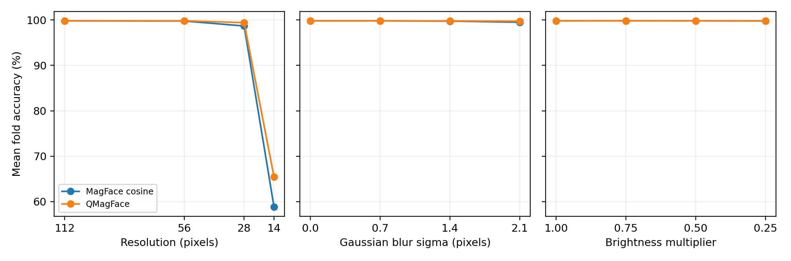
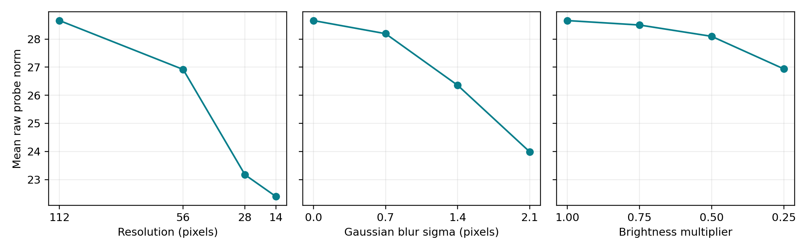

# Quality-Aware Face Verification Under Image Degradation

Reproducing and Investigating QMagFace | Dhrumil | Biometrics Project 2 | October 18, 2026

## Abstract

This project extends an existing face-verification degradation study by reproducing QMagFace, a published comparison rule that uses raw MagFace feature magnitude as image quality. On author-provided LFW features, the official evaluation yields 99.7497% for cosine scoring and 99.8331% for QMagFace, with 5,994 of 6,000 pairs covered. The independent scorer agrees with the official implementation within 5e-15. A separate ten-condition investigation holds the network and pair set fixed, degrades only the probe, and calibrates each scoring method exclusively on original-quality training folds. Original-image accuracy is 99.800% for cosine and 99.817% for QMagFace, on 5,999 scored pairs. At 14-pixel resolution, QMagFace raises accuracy from 58.827% to 65.411%, but its AUC falls from 0.951571 to 0.947902. This is an operating-point benefit under the frozen calibration policy, not evidence of universally better score ranking. Backbone training is not reproduced.

## 1. Problem and selected paper

The research question is whether adding image quality to comparison scoring improves face verification under resolution loss, Gaussian blur and reduced brightness relative to cosine similarity of exactly the same embeddings. The selected method is QMagFace: Simple and Accurate Quality-Aware Face Recognition, by Terhorst et al., published at IEEE/CVF WACV 2023 [1]. Its public implementation, pretrained network and feature artifacts make the comparison method independently testable. The project reproduces scoring and a benchmark protocol, then investigates controlled post-alignment degradation.

Project 1's VGGFace2-pretrained FaceNet system remains a historical reference: its recorded mean-fold accuracy was 99.167% on original images and 89.982% at 20 x 20 probe resolution. It used a different backbone and 160-pixel bounding-box crops. Those numbers are not a matched estimate of the QMagFace scoring effect. The principal comparison here is MagFace cosine versus QMagFace on identical raw MagFace embeddings; Project 1 code, results and history are preserved.

## 2. Reproduced method and implementation

For raw reference and probe embeddings e_r and e_p, let q_r and q_p be their L2 norms and s the cosine similarity of their unit-normalized versions. QMagFace applies the following comparison function [1,2]:

```bash
q_r = ||e_r||_2;  q_p = ||e_p||_2
s = dot(e_r/q_r, e_p/q_p)
score = s + min(0, beta*s - alpha) * min(q_r, q_p)
alpha = 0.077428;  beta = 0.125926
```

The coefficients remain fixed at the published QMagFace-100 values; we do not refit them on LFW or choose them per degradation. The adjusted score is not a probability and may be below -1. For a fixed cosine score below the weight cutoff, higher minimum quality causes a larger negative adjustment. The rule is therefore not a simple bonus added to every blurry image. Each scoring method needs its own decision threshold.

The audited MagFace iResNet100 checkpoint was trained on MS1MV2 [3]. It consumes aligned 112 x 112 BGR pixels divided by 255, with one forward pass and no flip aggregation. All 925 backbone entries are checked during safe weights-only loading. Raw 512-dimensional features, raw norms and normalized features are cached separately. The adapter matches the pinned author network bit for bit on two supplied test crops; a 16-image development pilot with no evaluation-image-path overlap also verified finite raw outputs and CPU/MPS agreement. These checks validate implementation compatibility, not recognition performance by themselves.

## 3. Author-feature benchmark reproduction

| Method | Paper (%) | Measured (%) | Gap (pp) | FM / FNM |
| --- | --- | --- | --- | --- |
| MagFace cosine | 99.73 | 99.7497 | +0.0197 | 3 / 12 |
| QMagFace | 99.83 | 99.8331 | +0.0031 | 2 / 8 |

Published comparison targets were checked in Table 2 of the final WACV proceedings paper. The authors' archive contains 13,227 raw LFW feature rows. Six requested pairs lack features: four genuine and two impostor. Coverage is 99.9%, leaving 2,996 genuine and 2,998 impostor pairs. The official loader excludes these pairs and then applies contiguous, unshuffled ten-fold KFold to the surviving list, so its fold membership differs from the original 6,000-pair fold assignments. Every exclusion is exported.

The official metric uses 600 thresholds spanning the global observed score minimum and maximum, accepts score > threshold and chooses the first threshold on a calibration tie. This was retained to reproduce the released evaluation, including its use of held-out score extrema to form the grid. It is distinct from the stricter calibration protocol used in the investigation. QMagFace corrects five cosine errors and introduces none in this run; ten pairs are wrong for both. The measured QMagFace result rounds to the published 99.83%, while MagFace's baseline is slightly higher than the published 99.73%. This is a close reproduction with explicit coverage/protocol qualifications, not exact recovery of every paper result.

## 4. Controlled investigation protocol

The original LFW funneled images, ordered 6,000-pair definitions and ten predefined folds are reused. A facenet-pytorch MTCNN selects the highest-confidence face containing the image center with probability at least 0.90. Five landmarks are fitted to a fixed ArcFace 112-pixel similarity template; Pillow bilinear affine sampling uses a black border. This is a separately documented alignment pipeline and does not claim to reconstruct the authors' benchmark alignment. Alignment is performed once before degradation, so the experiment measures post-alignment recognition rather than detection robustness.

| Family | Levels | Operation |
| --- | --- | --- |
| Original | 112 x 112 | No synthetic degradation |
| Resolution | 56, 28, 14 pixels | Bilinear downsample, then restore to 112 |
| Gaussian blur | sigma 0.7, 1.4, 2.1 | Separable sampled Gaussian; radius ceil(3*sigma); reflect border |
| Brightness | 0.75, 0.50, 0.25 | Multiply encoded RGB, without gamma correction or added noise |

Each condition starts independently from the original aligned probe crop; references remain original. Blur and brightness use float64 arithmetic, clipping and nearest-even uint8 quantization. Both scorers receive identical embeddings and pairs. For each held-out fold, each method maximizes accuracy on successful original-quality pairs in the other nine folds. Threshold candidates are score midpoints and finite accept-all/reject-all endpoints; ties choose the largest threshold and acceptance uses >=. The selected threshold is fixed for all held-out degradation conditions. No degraded test labels tune thresholds, model settings or coefficients. The full grid was frozen after the development pilot and before test inference.

Alignment succeeds for 7,700 of 7,701 unique evaluation images. Each condition requests 6,000 pairs and scores 5,999: 2,999 genuine and 3,000 impostor. Failures remain in predictions, per-label/fold coverage and reject-on-failure summaries. The following recognition rates condition on successful preprocessing; coverage is reported separately.

## 5. Measured robustness results

| Condition | Cosine accuracy (%) | QMagFace accuracy (%) | Delta (pp) | Net corrected |
| --- | --- | --- | --- | --- |
| Original | 99.800 | 99.817 | +0.017 | +1 |
| Resolution 56 | 99.767 | 99.817 | +0.050 | +3 |
| Resolution 28 | 98.683 | 99.417 | +0.733 | +44 |
| Resolution 14 | 58.827 | 65.411 | +6.585 | +395 |
| Blur 0.7 | 99.800 | 99.817 | +0.017 | +1 |
| Blur 1.4 | 99.750 | 99.783 | +0.033 | +2 |
| Blur 2.1 | 99.500 | 99.733 | +0.233 | +14 |
| Brightness 0.75 | 99.817 | 99.817 | +0.000 | +0 |
| Brightness 0.50 | 99.800 | 99.817 | +0.017 | +1 |
| Brightness 0.25 | 99.783 | 99.800 | +0.017 | +1 |

Accuracy is the equally weighted mean of the ten original folds; pp means percentage points. Net corrected is the number of cosine errors corrected by QMagFace minus newly introduced errors on the same pairs. Counts and fold means have slightly different weighting because one fold has an exclusion. Fold SD and SE are saved as descriptive summaries, not confidence intervals or significance tests.



QMagFace has a positive net decision gain for Original, Resolution 56, Resolution 28, Resolution 14, Blur 0.7, Blur 1.4, Blur 2.1, Brightness 0.50, Brightness 0.25; a negative gain for none; and equal total errors for Brightness 0.75. An equal total can still hide changed individual decisions; the exported paired-change table retains both corrected and introduced errors for every fold and condition.

| Condition | Cosine FM / FNM | QMagFace FM / FNM | Cosine FMR / FNMR (%) | QMagFace FMR / FNMR (%) |
| --- | --- | --- | --- | --- |
| Original | 1 / 11 | 1 / 10 | 0.033 / 0.367 | 0.033 / 0.333 |
| Resolution 56 | 1 / 13 | 0 / 11 | 0.033 / 0.433 | 0.000 / 0.367 |
| Resolution 28 | 0 / 79 | 2 / 33 | 0.000 / 2.634 | 0.067 / 1.100 |
| Resolution 14 | 0 / 2470 | 1 / 2074 | 0.000 / 82.361 | 0.033 / 69.156 |
| Blur 0.7 | 1 / 11 | 1 / 10 | 0.033 / 0.367 | 0.033 / 0.333 |
| Blur 1.4 | 1 / 14 | 0 / 13 | 0.033 / 0.467 | 0.000 / 0.433 |
| Blur 2.1 | 1 / 29 | 1 / 15 | 0.033 / 0.967 | 0.033 / 0.500 |
| Brightness 0.75 | 1 / 10 | 1 / 10 | 0.033 / 0.333 | 0.033 / 0.333 |
| Brightness 0.50 | 1 / 11 | 1 / 10 | 0.033 / 0.367 | 0.033 / 0.333 |
| Brightness 0.25 | 2 / 11 | 1 / 11 | 0.067 / 0.367 | 0.033 / 0.367 |

FM and FNM are pooled false matches and false nonmatches. FMR and FNMR use the pooled impostor and genuine denominators, respectively. The counts make tradeoffs visible when an accuracy improvement is partly obtained by accepting more pairs. All rates use the fixed original-calibrated thresholds.

Severe resolution loss: cosine accuracy is 58.827% and QMagFace accuracy is 65.411%. Quality-aware scoring corrects 398 cosine errors and introduces 3. Pooled FMR changes from 0.000% to 0.033%, while FNMR changes from 82.361% to 69.156%. Relative to its own original condition, cosine loses 40.973 accuracy points and QMagFace loses 34.405 points.

Severe blur: cosine accuracy is 99.500% and QMagFace accuracy is 99.733%. Quality-aware scoring corrects 14 cosine errors and introduces 0. Pooled FMR changes from 0.033% to 0.033%, while FNMR changes from 0.967% to 0.500%. Relative to its own original condition, cosine loses 0.300 accuracy points and QMagFace loses 0.083 points.

Severe brightness reduction: cosine accuracy is 99.783% and QMagFace accuracy is 99.800%. Quality-aware scoring corrects 2 cosine errors and introduces 1. Pooled FMR changes from 0.067% to 0.033%, while FNMR changes from 0.367% to 0.367%. Relative to its own original condition, cosine loses 0.017 accuracy points and QMagFace loses 0.017 points.



The pair-weighted mean raw probe norm is 28.658 on original images, 22.397 at 14 pixels, 23.983 at blur sigma 2.1 and 26.939 at brightness 0.25. These observations quantify how the pretrained quality estimate responds to our transformations. They do not prove that feature magnitude orders every possible real-world image degradation correctly. Reference-quality distributions remain fixed because reference images are never transformed.

| Condition | Cosine AUC | QMagFace AUC | Cosine EER (%) | QMagFace EER (%) |
| --- | --- | --- | --- | --- |
| Original | 0.999528 | 0.999579 | 0.267 | 0.267 |
| Resolution 56 | 0.999439 | 0.999436 | 0.233 | 0.267 |
| Resolution 28 | 0.998936 | 0.998924 | 0.667 | 0.633 |
| Resolution 14 | 0.951571 | 0.947902 | 11.667 | 12.104 |
| Blur 0.7 | 0.999491 | 0.999525 | 0.233 | 0.267 |
| Blur 1.4 | 0.999391 | 0.999368 | 0.233 | 0.233 |
| Blur 2.1 | 0.999226 | 0.999127 | 0.433 | 0.367 |
| Brightness 0.75 | 0.999507 | 0.999554 | 0.267 | 0.267 |
| Brightness 0.50 | 0.999494 | 0.999535 | 0.233 | 0.267 |
| Brightness 0.25 | 0.999418 | 0.999399 | 0.267 | 0.267 |

Pooled ROC AUC and interpolated EER describe score ranking across all scored pairs and threshold sweeps. Their thresholds are not used for held-out predictions. The full ROC/DET curves, genuine/impostor score distributions, raw-quality distributions and original-condition paired changes accompany the report.

The severe-resolution result illustrates why fixed-threshold accuracy and ranking must be separated. At 14 pixels, QMagFace gains 6.585 accuracy points, yet AUC decreases from 0.951571 to 0.947902 and EER increases from 11.667% to 12.104%. Thus the gain at the original-calibrated operating point does not show globally better discrimination. For the active quality-adjustment branch and minimum norm m, the score is (1 + beta*m)*s - alpha*m. A fixed adjusted-score threshold T corresponds to a cosine cutoff (T + alpha*m)/(1 + beta*m). At the negative thresholds measured here, this cutoff decreases as quality decreases. This explains how the rule can recover genuine acceptances under degradation while allowing additional false matches; it does not recover the visual information removed by downsampling.

## 6. Limitations and interpretation

This project reuses a pretrained backbone and fixed published coefficients; it does not reproduce MagFace training, QMagFace parameter fitting or every paper dataset. Author-feature reproduction and our aligned-image investigation have different coverage and threshold protocols, so their absolute accuracies must not be conflated. The 14-pixel condition is a relative-scale extension of Project 1's 20-pixel condition, not an identical crop or whole-system comparison.

LFW contains repeated subjects and images, and the ten calibration sets overlap. The study therefore reports descriptive paired changes rather than treating folds or conditions as independent experimental replicates. A small gain of a few errors is not proof of a population-level advantage. With about 3,000 impostor comparisons, a single false match is approximately 0.033 percentage points of FMR; the sample cannot establish extreme low-FMR performance or make zero observed errors imply zero risk.

Synthetic brightness scaling is not a physical low-light camera model: it adds neither sensor noise nor exposure-dependent artifacts. Fixed alignment excludes degradation-induced detection failures. Training/evaluation identity overlap was not independently audited. No demographic fairness analysis or deployment recommendation is supported by these data. The publicly documented research artifacts are used locally; model weights, faces and large feature caches are excluded from the submission repository.

## 7. Conclusions and reproducibility

The comparison function and author-feature benchmark have been reproduced with numerical agreement and explicit protocol differences. The robustness experiment isolates the scoring rule by holding the feature extractor and pairs fixed, with each method's separately calibrated threshold held fixed across conditions. QMagFace improves fixed-threshold accuracy in 9 of ten conditions and ties in 1; its largest gain is 6.585 points at 14 pixels. However, even there it rejects 69.156% of genuine pairs, and its ranking metrics are worse than cosine. Blur shows a smaller gain, while brightness effects are only zero or one net corrected decision. Quality-aware scoring is useful for this frozen-threshold policy, but the results do not support a blanket claim that it solves image degradation or dominates cosine at every operating point.

The reference environment is Python 3.13.7, NumPy 2.5.3, PyTorch 2.8.0, torchvision 0.23.0, facenet-pytorch 2.5.3 and Pillow 11.2.1 on macOS arm64. Inference used MPS with batches of 32 and two CPU threads for alignment. A separate benchmark environment adds scipy 1.16.2 and scikit-learn 1.7.2 without replacing Project 1 dependencies. The checkpoint's observed SHA-256 is cfeba792dada6f1f30d1e118aff077d493dd95dd76c77c30f57f90fd0164ad58; this is a local observed hash, not a publisher-signed checksum.

```bash
.venv/bin/python -m unittest discover -s tests -v
.venv/bin/python scripts/check_project2.py
.venv/bin/python scripts/project2_reanalyze.py
.venv/bin/python -m src.project2_experiment \
  --stage run --device mps --grid full --batch-size 32
```

Use --device cpu on systems without MPS. The detailed acquisition and clean-environment instructions are in docs/project2/reproduce.md; the artifact audit, frozen protocol, AI-assistance record and experiment log document decisions and provenance. Machine-readable scores preserve failed attempts, original folds, both raw qualities and both scores. Predictions retain method-specific thresholds. Manifests record source/output hashes, software versions, checkpoint identity and timing. The repository checker re-evaluates saved pairs and detects corrupt, stale or mismatched outputs; optional cache checks reconstruct scores from raw features. The submission retains the actual .git history.

## References

[1] P. Terhorst, M. Ihlefeld, M. Huber, N. Damer, F. Kirchbuchner, K. Raja and A. Kuijper. QMagFace: Simple and Accurate Quality-Aware Face Recognition. IEEE/CVF WACV, 2023, pp. 3484-3494. https://openaccess.thecvf.com/content/WACV2023/html/Terhorst_QMagFace_Simple_and_Accurate_Quality-Aware_Face_Recognition_WACV_2023_paper.html

[2] Authors' QMagFace code and artifact links. https://github.com/pterhoer/QMagFace Commit 395797145da1b1b263cbe7fb1564c6ea91f55b23 (accessed October 18, 2026).

[3] Q. Meng, S. Zhao, Z. Huang and F. Zhou. MagFace: A Universal Representation for Face Recognition and Quality Assessment. IEEE/CVF CVPR, 2021. https://github.com/IrvingMeng/MagFace Commit 99bae614ac2643b9694bf18e0c5645272ff6acfa.

[4] Labeled Faces in the Wild, funneled images and official pair files, distributed through the scikit-learn/figshare mirror. Source URLs and verified dataset hashes are recorded in src/lfw_dataset.py and docs/dataset_research.md.
