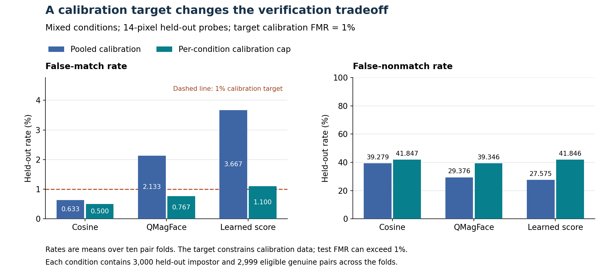

# Extension: thresholds calibrated for 1% FMR

**A 1% calibration target does not guarantee 1% false matches on held-out
faces.** In mixed-condition training, the learned score's pooled policy produces
3.667% FMR at 14 pixels, although its average FMR across all ten test conditions
is 1.037%. Capping each observed calibration condition lowers the 14-pixel FMR
to 1.100%, but raises FNMR from 27.575% to 41.846%.

## Why this experiment was added

Project 2 feedback identified the omitted target-FMR analysis as unfinished
work. This extension completes that investigation with a
[protocol committed before execution](operating_points_protocol.md). It retains
the earlier accuracy-oriented experiment and asks a different question: what
false-nonmatch cost accompanies thresholds calibrated to a specified false-match
target? No setting was selected from these new test results.

For each original LFW test fold, seven other folds fit a fresh logistic
interaction model and its scaler; two separate folds calibrate thresholds.
Every variant of a pair stays in its assigned role. Cosine and published
QMagFace are fixed scorers. All methods receive the same calibration/test pairs.
The learned model keeps `C=1` and is not refitted after threshold selection.

The **pooled** policy constrains the mixture of calibration conditions. The
**condition-cap** policy takes the maximum of the separate per-condition
thresholds, enforcing the empirical target within every observed calibration
condition. Both apply one shared threshold to all test conditions. Boundary
ties are rejected as a group, using only calibration impostor scores.

The [manifest](../../results/project3/operating_points/manifest.json) records
30 learned fits, 180 threshold configurations, and 864,000 requested prediction
rows; the exports contain 144 aggregate rows. These include repeated conditions,
policies, methods, and excluded attempts. The experiment reused saved Project 2
measurements; there was no new image inference.

## Mixed training: strongest resolution degradation

All methods below use mixed fitting and calibration conditions and evaluate the
same 5,999 eligible 14-pixel pairs. Rates are **mean-fold percentages**; counts
pool 3,000 impostor and 2,999 genuine pairs. The target is a calibration
constraint, not an assertion about these test rates.

| Method | Threshold policy | Test FMR (%) | Test FNMR (%) | False matches | False nonmatches |
|---|---|---:|---:|---:|---:|
| Cosine | Pooled | 0.633 | 39.279 | 19 | 1,178 |
| Cosine | Condition cap | 0.500 | 41.847 | 15 | 1,255 |
| QMagFace | Pooled | 2.133 | 29.376 | 64 | 881 |
| QMagFace | Condition cap | 0.767 | 39.346 | 23 | 1,180 |
| Learned interaction | Pooled | 3.667 | 27.575 | 110 | 827 |
| Learned interaction | Condition cap | 1.100 | 41.846 | 33 | 1,255 |

The learned pooled score rejects fewer genuine pairs than pooled QMagFace, but
accepts 46 additional impostors. Its condition cap removes 77 false matches
while introducing 428 additional false nonmatches. Under the cap policy,
QMagFace has fewer errors of both kinds than the learned score. No method
provides a uniformly better tradeoff.

Pooled calibration can conceal a difficult condition even before testing: for
the mixed learned score, an individual calibration condition reaches 4.000%
FMR while the overall calibration mixture satisfies its 1% budget. The cap
keeps every included calibration condition at or below 1%. On held-out data,
the mixed pooled macro FMRs are 1.003% for cosine, 1.007% for QMagFace, and
1.037% for the learned score; these averages obscure the 14-pixel rates above.

## Original-only and excluded-resolution calibration

The following table compares the **learned interaction model** across all
three regimes at 14 pixels, within this new seven/two/one-fold experiment.

| Fitting/calibration regime | Pooled FMR (%) | Pooled FNMR (%) | Cap FMR (%) | Cap FNMR (%) |
|---|---:|---:|---:|---:|
| Original only | 8.867 | 15.804 | 8.867 | 15.804 |
| Mixed | 3.667 | 27.575 | 1.100 | 41.846 |
| Resolution excluded | 4.100 | 23.407 | 1.933 | 32.211 |

Original-only calibration makes the policies identical. Its low 14-pixel FNMR
comes with 266 false matches, far above the calibration target. Original-only
QMagFace similarly gives 6.800% FMR and 18.071% FNMR; cosine gives 0.800% and
37.911%. These are different operating tradeoffs, not equal achieved FMRs.

With resolution excluded, the cap applies only to original, blur, and brightness
calibration examples. At 14 pixels it yields 1.933% FMR for the learned score
(58 false matches), 1.700% for QMagFace (51), and 0.500% for cosine (15).
Their FNMRs are 32.211%, 32.778%, and 41.647% respectively. The calibration cap
does not protect an unseen family, and the learned score's lower FNMR than
mixed training accompanies a higher FMR.

## Interpretation and evidence

Each calibration split contains 600 unique impostor pairs: a per-condition
budget of six false matches. Mixed calibration has 6,000 correlated variants,
not 6,000 independent pairs. Each test fold has 300 impostors, so one false
match changes its FMR by about 0.333 percentage points. Observed target
exceedances are retained; they are not used to tune again.

These results compare methods and policies within this extension. The earlier
study fitted on nine folds and used another decision objective, so differences
from it are not a controlled threshold-only effect. LFW image/identity overlap,
repeated conditions, fixed alignment, and synthetic degradations also remain
limitations. There is no statistical-significance or deployment guarantee.

Full evidence: [test aggregates](../../results/project3/operating_points/aggregates.csv),
[fold results](../../results/project3/operating_points/folds.csv),
[calibration counts](../../results/project3/operating_points/calibration.csv), and
[threshold records](../../results/project3/operating_points/thresholds.json).
The completed analysis addresses the omitted operating-point question while
showing why both achieved FMR and FNMR must accompany a stated target.

Fourteen focused tests passed. The independent
[operating-point audit](operating_points_validation.json) reconstructed all
180 thresholds and 864,000 requested predictions, with zero score discrepancy.
One [fresh CLI rerun](operating_points_reproducibility.json) reproduced all six
payload files byte for byte. The main run took 9.913 seconds in the recorded
environment; the repeat took 10.387 seconds.
