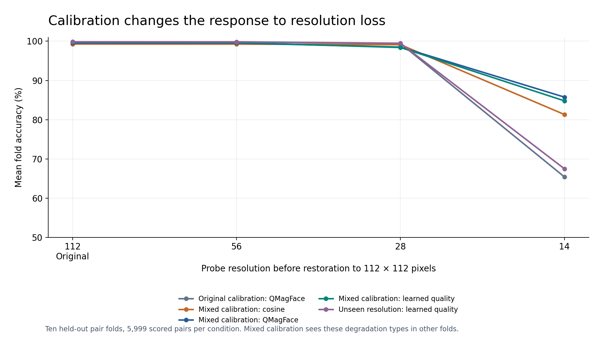
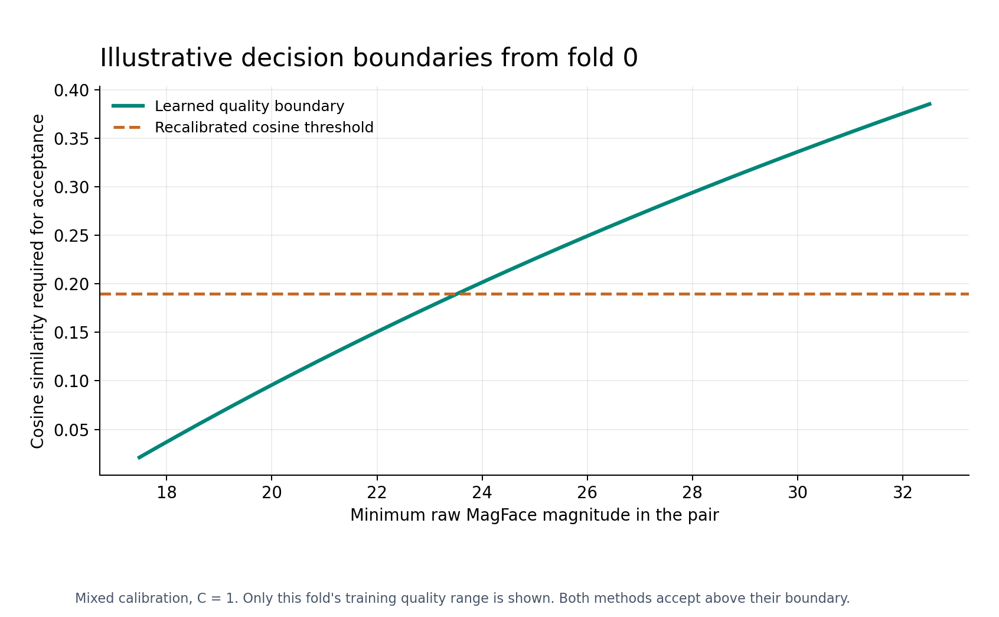

# Project 3 results: first calibration study

This page preserves the original accuracy-oriented study. The subsequent
[target-FMR extension](operating_points.md) addresses the Project 2 feedback
with separate model-fitting, threshold-calibration and test folds.

**Calibration exposure explains substantial improvement under severe resolution
loss, but the learned interaction score does not consistently beat a recalibrated
QMagFace threshold.** At 14 pixels, changing QMagFace's calibration data raises
accuracy from 65.411% to 85.748%. The full learned score reaches 84.798%, with
both more false matches and more false nonmatches than that same-data control.
Quality features help the logistic model, while the extra interaction has mixed
benefits. Performance falls sharply when resolution degradation is excluded
from training.

## Study and evidence

The [prospective protocol](protocol.md) fixes the experiment before the new run.
It builds on [QMagFace](https://arxiv.org/abs/2111.13475),
[MagFace](https://arxiv.org/abs/2103.06627), and
[face-score calibration research](https://doi.org/10.1049/iet-bmt.2013.0066).
This is a course-project extension of the comparison and decision stages.

The run reused Project 2's measured scores for 5,999 eligible LFW pairs across
ten conditions, with 2,999 genuine and 3,000 impostor pairs per condition. All
variants of a held-out pair remained outside training. Each fold's scaler,
model, and scalar thresholds used only the other nine folds. Primary logistic
models used fixed `C=1` and a zero logit threshold. No new embeddings or images
were computed. The [manifest](../../results/project3/calibration/manifest.json)
records 290 fitted models, 1,128,000 requested prediction rows, and 18.818 seconds
for this saved-score experiment; the rows include repeated methods, regimes,
conditions, and excluded attempts, not independent people.

All percentages below are **means over the ten original folds** unless stated
otherwise. AUC and EER are calculated within each fold and then averaged;
Project 2's pooled ROC summaries are a different aggregation. Counts are pooled
over eligible pairs. Source evidence is in
[aggregates.csv](../../results/project3/calibration/aggregates.csv),
[folds.csv](../../results/project3/calibration/folds.csv), and
[paired_changes.csv](../../results/project3/calibration/paired_changes.csv).

Thirteen Project 3 unit tests passed. The independent
[saved-result audit](validation.json) verified all fitted models and predictions;
one [complete CLI rerun](reproducibility.json) reproduced all five payload files
byte for byte in the recorded environment. Neither check repeated image
alignment or embedding inference.

## Mixed-condition calibration: every condition

All five methods below receive the same ten training conditions. `s` is cosine
similarity and `q` is the minimum raw MagFace norm of the two faces. The three
logistic columns use the indicated features; the other columns fit a scalar
threshold to cosine or the unchanged published QMagFace score.

| Held-out condition | Cosine | QMagFace | Logistic `s` | Logistic `s,q` | Logistic `s,q,s*q` |
|---|---:|---:|---:|---:|---:|
| Original | 99.283 | 99.550 | 99.467 | 99.783 | 99.767 |
| Resolution 56 | 99.267 | 99.533 | 99.333 | 99.683 | 99.650 |
| Resolution 28 | 99.116 | 98.500 | 99.167 | 98.450 | 98.400 |
| Resolution 14 | 81.314 | 85.748 | 79.563 | 84.681 | 84.798 |
| Blur 0.7 | 99.200 | 99.583 | 99.450 | 99.767 | 99.767 |
| Blur 1.4 | 99.183 | 99.350 | 99.367 | 99.650 | 99.600 |
| Blur 2.1 | 99.183 | 98.633 | 99.383 | 99.016 | 98.900 |
| Brightness 0.75 | 99.267 | 99.533 | 99.467 | 99.783 | 99.750 |
| Brightness 0.50 | 99.300 | 99.550 | 99.417 | 99.750 | 99.717 |
| Brightness 0.25 | 99.183 | 99.433 | 99.367 | 99.700 | 99.667 |
| Equal-condition mean | 97.430 | 97.941 | 97.398 | 98.026 | 98.001 |

The figure's learned-quality curves use the full interaction model at `C=1`.

### What comes from recalibration?

Using original-quality training alone, the cosine and QMagFace thresholds give
58.827% and 65.411% accuracy at 14 pixels. Mixed-condition calibration raises
those same scorers to 81.314% and 85.748%: gains of 22.487 and 20.336 percentage
points without changing their scores. Thus a large operating-point gain can
come from including degraded training examples.

The gain has costs elsewhere. QMagFace's original-quality accuracy falls from
99.817% to 99.550%, and its strongest-blur accuracy falls from 99.733% to
98.633%. The equal-condition mean weights the severe setting as one of ten
conditions; another deployment mix could favor a different operating point.

### What comes from quality and the interaction?

At 14 pixels, adding `q` to the logistic score improves accuracy from 79.563%
to 84.681%; adding `s*q` gives a further 0.117 percentage points, to 84.798%.
However, the interaction reduces the equal-condition mean from 98.026% to
98.001%. The simpler quality model also has higher original-quality and
strongest-blur accuracy. The added interaction therefore has no consistent
advantage across conditions.

Against mixed-calibration QMagFace, the full model corrects 51 errors and
introduces 108 at 14 pixels: **57 fewer correct decisions**. On original-quality
pairs it corrects 14 errors and introduces one: 13 additional correct decisions.
This is a condition-dependent tradeoff, not universal superiority.

This mixed-training fold illustrates the modification: the full model changes
the required cosine similarity with quality. It is one fitted fold's boundary,
not an aggregate or evidence of improved accuracy by itself.

## False-match costs and score ranking

At the strongest resolution degradation, the mean-fold error rates are:

| Mixed-calibration method | Accuracy (%) | FMR (%) | FNMR (%) |
|---|---:|---:|---:|
| Cosine | 81.314 | 0.833 | 36.545 |
| QMagFace | 85.748 | 3.033 | 25.475 |
| Logistic `s` | 79.563 | 0.633 | 40.246 |
| Logistic `s,q` | 84.681 | 3.833 | 26.808 |
| Logistic `s,q,s*q` | 84.798 | 4.033 | 26.375 |

The full model makes 121 false matches and 791 false nonmatches. Recalibrated
QMagFace makes 91 and 764 respectively, so it has lower rates of both error
types at this operating point. The original-only QMagFace threshold had one
false match and 2,074 false nonmatches; accepting more degraded genuine pairs
does not preserve that low observed false-match count.

Threshold adaptation leaves a scorer's ranking unchanged. At 14 pixels,
cosine retains mean AUC 0.951617 and mean EER 11.804% in both original-only and
mixed training. Mixed QMagFace gives 0.947744 and 12.071%; the full learned
score gives 0.939861 and 12.967%. Its improved accuracy relative to the frozen
Project 2 operating point does **not** establish better ranking. This first
study did not optimize a low-FMR target; the separate
[operating-point experiment](operating_points.md) now evaluates a 1%
calibration target. With 3,000 impostor pairs, neither study establishes
reliable ultra-low-FMR performance.

The [error-count figure](../../results/project3/analysis/resolution14_errors.png)
shows the pooled counts and their denominators; its rates use pooled counts
rather than the mean-fold convention of the table above.

## Transfer to excluded degradation families

Each row below excludes all three levels of the named family from training
and evaluates its strongest level on held-out pairs. Original faces and the
other two families remain available for training.

| Excluded family / strongest test | Cosine accuracy (%) | QMagFace accuracy (%) | Full model accuracy (%) | Full FMR (%) | Full FNMR (%) |
|---|---:|---:|---:|---:|---:|
| Resolution / 14 pixels | 63.911 | 66.078 | 67.478 | 0.067 | 64.987 |
| Blur / sigma 2.1 | 99.183 | 98.533 | 98.666 | 2.433 | 0.233 |
| Brightness / factor 0.25 | 98.917 | 99.433 | 99.600 | 0.533 | 0.267 |

The full model's 14-pixel accuracy falls from 84.798% with mixed training to
67.478% when resolution is excluded, a loss of 17.319 percentage points. Its
improvement over QMagFace in that excluded-family setting is modest and does
not recover the mixed-training result. On the strongest excluded blur, cosine
is more accurate than either quality-aware alternative. On excluded brightness,
the full model improves on both scalar controls. Across all three levels of
each excluded family, its average accuracies are 88.932%, 99.283%, and 99.644%
for resolution, blur, and brightness respectively. These results support
limited, family-dependent transfer.

The [quality diagnostics](../../results/project3/analysis/summary.json) show that
only 4 of 5,999 held-out 14-pixel pairs (0.0667%) have `q` outside their training
folds' ranges when resolution is excluded. All evaluated learned scores have
positive cosine slopes at the observed held-out quality values. Thus the poor
transfer occurs predominantly within the observed quality range, without
reversed cosine ordering at fixed quality. This range check does not establish
matching joint score/quality distributions or identify a single cause.

## Sensitivity and conclusion

The planned sensitivity analysis varies only the full model's regularization.
`C=1` remains the primary setting; no winning value was chosen after evaluation.

| C | Mixed: 14-pixel accuracy (%) | Mixed: original accuracy (%) | Mixed: 14-pixel FMR (%) | Resolution excluded: 14-pixel accuracy (%) |
|---|---:|---:|---:|---:|
| 0.1 | 82.364 | 99.817 | 2.533 | 64.278 |
| 1 | 84.798 | 99.767 | 4.033 | 67.478 |
| 10 | 85.148 | 99.733 | 4.433 | 69.062 |

Weaker regularization improves severe-resolution accuracy here while increasing
false matches and reducing original-quality accuracy in mixed training. It
does not change the central finding: calibration data and operating-point
choices matter, and quality-aware learning has conditional benefits.
The [sensitivity figure](../../results/project3/analysis/regularization_sensitivity.png)
plots the same planned settings.

This study does not establish performance on new identities or a new dataset.
LFW was inspected during earlier projects; pair folds share image/identity
occurrences, and folds share calibration data. Repeated conditions are correlated.
The fixed-alignment, synthetic-degradation setting also omits degraded-image
detection and real sensor noise. The learned logits are decision scores rather
than validated probabilities. Reported differences are descriptive, without
claims of statistical significance, demographic fairness, or deployment
readiness. Project 1 remains historical system context because its FaceNet
backbone and preprocessing differ. Within this scope, the capstone establishes
that a simple recalibration control is essential before attributing a gain to
a more elaborate comparison model.
